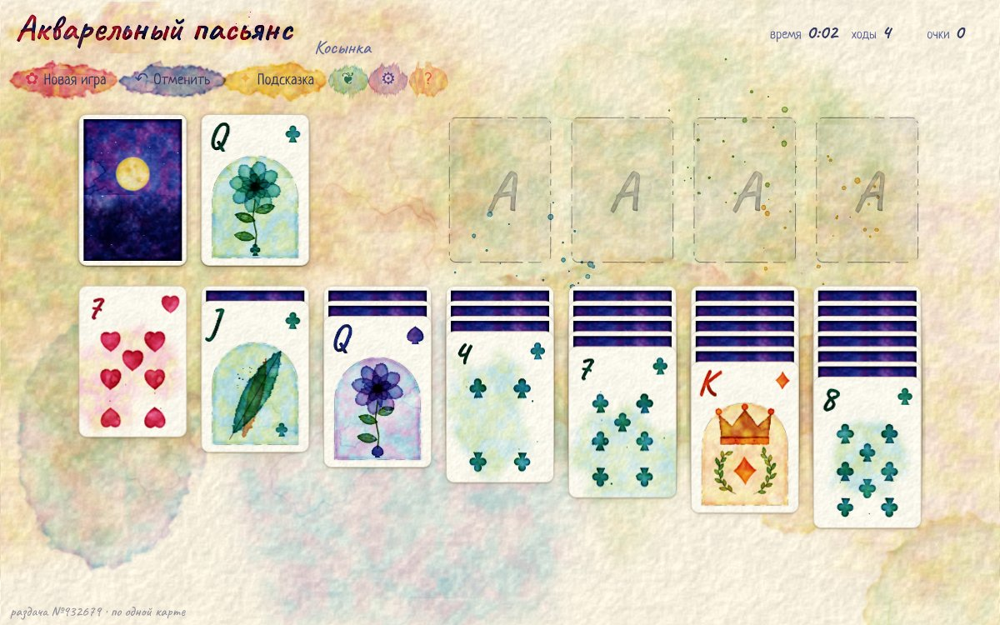

# Акварельный пасьянс · Watercolor Solitaire

**Пасьянс «Косынка» с картами, нарисованными акварелью**

**[▶ Играть в браузере](https://n1x-plut0.github.io/solitaire/)**

## Как играть

Соберите все карты в четыре стопки «дома» (справа вверху): каждую масть от туза до короля.

- В семи столбцах карты кладут по убыванию и чередуют цвета: тёплые ♥ ♦ и холодные ♠ ♣.
- Можно переносить сразу несколько открытых карт, если они уже лежат по порядку.
- На пустое место в столбце можно положить только короля.
- Нажмите на колоду, чтобы открыть карты. Когда она кончится, нажмите ещё раз: колода перевернётся.
- Карты можно перетаскивать или просто нажимать на них: карта сама переедет в подходящее место.

| Клавиша | Действие |
|:---:|---|
| Пробел | открыть карту из колоды |
| Z / Ctrl+Z | отменить ход |
| H | подсказка |
| N | новая игра |

## Что есть в игре

- **Два режима:** по одной карте (спокойный) и по три (классика).
- **Номер раздачи:** любую раздачу можно сыграть заново или отправить другу её номер.
- **Отмена ходов** без ограничений и **подсказка**, которая подсвечивает карту и место для неё.
- **Автоперенос:** карты, которые уже не нужны на столе, сами уходят в «дом» (можно выключить).
- Когда все карты открыты, появляется кнопка **«Собрать карты»**.
- **Очки и бонус за скорость**, а также статистика: процент побед, лучшее время, серии.
- Игра **сохраняется** в браузере, после перезагрузки можно продолжить.
- Работает на компьютере и на телефоне. Есть русский и английский язык.

## Дизайн

Всё нарисовано кодом, в игре нет ни одной картинки: при загрузке страница сама «пишет» колоду на `<canvas>`.

- **Акварельная заливка.** Каждая масть складывается из 20–35 полупрозрачных слоёв. Каждый слой — немного искажённый контур, поэтому края мягкие и неровные. По краю пигмент темнее, как у высохшей акварели, а в середине есть светлое пятно, будто краску приподняли кистью.
- **Бумага.** У карт тёплая бумага с зерном, а поверх краски наложена грануляция пигмента.
- **Масти.** Холодные масти: пики индиго и трефы цвета морской волны. Тёплые: червы малиновые, бубны оранжевые. Индексы написаны от руки (шрифт Caveat) и крупно стоят вверху карты, поэтому их видно даже в плотном столбце.
- **Фигуры в технике «линия и заливка»** (тонкий контур тушью поверх акварели): у **короля** корона с камнями, у **дамы** цветок, у **валета** перо. Тузы — большая масть с ореолом и брызгами.
- **Три рубашки:** «Ночь» (луна и звёзды), «Луг» (холмы и цветы), «Закат» (солнце над морем).
- **Три стола:** «Бумага», «Шалфей», «Сумерки». Это большие размывы акварели на бумаге.
- **Анимации:** карты переворачиваются в 3D, при попадании в «дом» расплывается акварельная клякса, а после победы карты прыгают по экрану и оставляют полупрозрачный красочный след.
- Кнопки похожи на мазки краски: у них неровные края (SVG-фильтр turbulence).

Все случайности посеяны (seeded random), поэтому колода выглядит одинаково при каждом заходе.

## Файлы

| Файл | Что внутри |
|---|---|
| `index.html` | разметка, окна (новая игра, настройки, статистика, правила, победа) |
| `style.css` | стол, карты, кнопки-мазки, окна, вёрстка для телефона |
| `js/paint.js` | акварельный «художник»: карты, рубашки, столы, кляксы |
| `js/game.js` | правила Косынки, раскладка, перетаскивание, отмена, подсказки, статистика |

## Запуск

Скачайте репозиторий и откройте `index.html` в браузере. Сборка и сервер не нужны.

**GitHub Pages:** в репозитории откройте **Settings → Pages**, выберите **Deploy from a branch → `main` / `(root)`**. Через минуту игра будет доступна по адресу https://n1x-plut0.github.io/solitaire/.

---

*English: a Klondike solitaire where every card is painted in watercolor by code when the page loads. Draw one or draw three, unlimited undo, hints, auto-move, statistics, three card backs and three tables. Open `index.html` or play on GitHub Pages.*
